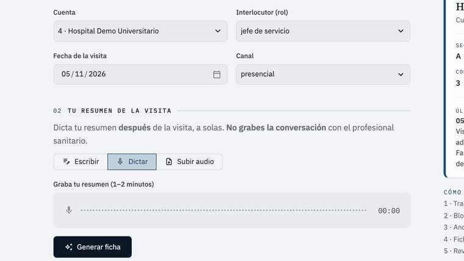
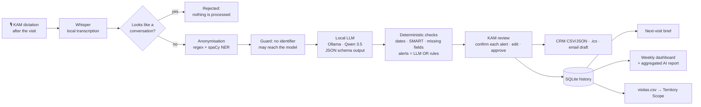

# Post-Call Assistant KAM

**From a one-minute post-visit dictation to an approved, compliant CRM record — with a local AI, and the Key Account Manager in charge.**

▶ **40-second demo:** https://youtu.be/6jJMFs4iWzM · built as part of my application for *Key Account Manager Neuroscience (Tech-Forward)*.



> The app's interface is in Spanish (it is built for a KAM working in Spain); this README is in English.
> All notes, accounts and people in this repository are **synthetic**.

---

## The problem

After each visit, a KAM has to log it in the CRM, write down the next step and remember what the physician asked for. It
usually happens late, from memory: details get lost, follow-ups slip, and compliance duties — reporting a possible adverse
event, routing an off-label question to Medical — depend on someone remembering them.

## The solution

Leaving the consultation, alone, the KAM dictates a one-minute summary of the visit (**the visit itself is never
recorded**). The app:

1. **Transcribes** it locally (Whisper) and **rejects** anything that looks like a recorded conversation.
2. **Anonymises** it before any AI sees it: patient names, ages and identifiers → `[PACIENTE]`, `[EDAD]`, `[NHC]`…;
   physicians → their role.
3. **Structures** it with a local LLM into a CRM-ready record: objective (with a SMART check), outcome, topics, needs,
   objections, materials, next step and owner, follow-up date, receptivity, cross-functional requests, CRM summary.
4. **Flags compliance alerts** — possible adverse event, possible off-label question, medical-information request — and
   **blocks approval** until the KAM confirms *"I have notified Pharmacovigilance"* / *"I have referred it to Medical"*.
5. After **the KAM reviews and approves**, it produces the CRM record (CSV/JSON), an `.ics` follow-up reminder and a
   neutral follow-up email draft — and **never sends anything by itself**.
6. Every approved visit feeds the **next-visit brief** of the account (pending commitments, open objections, materials,
   recent alerts) and a **weekly dashboard** for the manager, with an AI-drafted weekly report that receives aggregated
   numbers only.

## How it works



| Layer | What it does | Where |
|---|---|---|
| Transcription | faster-whisper `small`, Spanish, domain vocabulary prompt; audio deleted after use | `src/transcribe.py` |
| Conversation guard | rejects recorded dialogues before anything else runs | `src/conversation.py` |
| Anonymisation | regex (DNI/NIE, SIP, medical record no., phones, emails, birth dates, long numbers) + spaCy names + final guard | `src/anonymize.py` |
| Structuring | Ollama (`qwen3.5:9b`) with a Pydantic JSON schema; Claude API available as an optional provider | `src/llm.py`, `schema/visit_record.py`, `prompts/system_prompt.md` |
| Validation | follow-up dates computed from the literal expression, SMART deadline check, summary wording checks | `src/dates.py`, `src/validate.py` |
| Compliance alerts | LLM **or** rule-based safety net — a false positive is cheaper than a missed adverse event | `src/alert_rules.py` |
| Outputs | CRM CSV/JSON, RFC 5545 `.ics`, email draft that never mentions adverse events or answers clinical questions | `src/outputs.py` |
| History & weekly | SQLite (approved records only), next-visit brief, weekly aggregates and report | `src/storage.py`, `src/weekly.py` |

## Compliance by design

- **The visit is never recorded.** Only the KAM's own dictation, after the visit; recorded conversations are rejected.
- **Zero patient data to the AI.** Anonymisation runs before the model; a final guard refuses to send any text that
  still contains an identifier. The screen shows exactly what the model received.
- **Zero physician names.** Names are replaced by the role (psiquiatra infantil, jefe de servicio…).
- **Human in the loop.** The AI proposes; nothing is saved or exported without explicit approval, and every alert needs its
  own confirmation checkbox.
- **Nothing is sent automatically** — no emails, no notifications, no CRM writes.
- **Alerts are reminders, not decisions.** The app never states whether a question is on- or off-label and never answers
  clinical questions; it routes them to Pharmacovigilance or Medical.
- **No invented content.** Fields not dictated stay empty and are listed as missing; CRM summaries are checked for
  wording that asserts causality ("adverse event" without "possible") or judges label status.
- **Local and free.** Transcription and LLM run on the laptop (Whisper + Ollama); no paid API is needed.
- **No brands or commercial products** anywhere in the app.

## Results on the synthetic test set

20 synthetic notes written to cover normal visits, non-SMART objectives, incomplete notes, 3 possible adverse events,
3 possible off-label questions, 5 medical-information requests, patient data to anonymise, physician names and one
recorded conversation. Model: `qwen3.5:9b` running locally. Full table: [`docs/evaluation_phase2.md`](docs/evaluation_phase2.md).

| Alert | Source | Sensitivity | Specificity |
|---|---|---|---|
| Possible adverse event (n = 3) | LLM + rules | **100 %** | **100 %** |
| Possible off-label question (n = 3) | LLM + rules | **100 %** | **100 %** |
| Medical-information request (n = 5) | LLM + rules | **100 %** | 93 % |

| Metric | Result |
|---|---|
| Patient identifiers / physician names in the text sent to the model | **0** (20 notes + 9 extra unit cases) |
| Recorded conversation detected | 20 / 20 |
| Key fields auto-filled | 78 % on average |
| Note → approved record, end to end in the app | 57 s, 113 s and 138 s in three runs (target < 120 s; the slowest includes scripted edits) |
| Real 47-second voice note → proposed record | 67 s (6 s transcription + 61 s local LLM) |
| Automated tests | 155 (anonymisation, alerts, dates, schema, outputs, storage, weekly, demo mode, full UI flows) |

## Limitations

- **Small, synthetic test set.** 3–5 positives per alert type; the rule-based safety net was written while looking at
  these 20 notes, so its 100 % is optimistic. A held-out set of notes written by someone else is the next step.
- **Transcription errors happen** ("tratamiento" heard as "tramil todo"): the alert fragment can be corrected before approval.
- **Conversation detection is text-based**, not speaker diarisation.
- **A 9B local model needs ~11 GB of RAM**; the app unloads it 30 s after each note.
- It is a **support tool**: it does not replace the company's Pharmacovigilance and Medical Information procedures.

## Run it

**Public demo** (Streamlit Community Cloud): runs in demo mode — the synthetic example notes are replayed with records
pre-generated by the local model; everything after the model (rules, dates, alerts, review, outputs, history, dashboard)
runs for real. Your own notes and dictation need the local setup.

**Locally, with the full pipeline:**

```bash
git clone https://github.com/miriammartinezsantos625-source/post-call-assistant-kam && cd post-call-assistant-kam
python3.12 -m venv .venv && .venv/bin/pip install -r requirements-local.txt
ollama pull qwen3.5:9b            # https://ollama.com
.venv/bin/streamlit run app.py
```

Demo mode locally: `POSTCALL_DEMO=1 .venv/bin/streamlit run app.py`. Evaluation: `.venv/bin/python -m scripts.evaluate`.
Tests: `.venv/bin/python -m pytest`.

Integration with **Territory Scope** (my territory-planning app): same `cuenta_id` key; `visitas.csv` export
(`cuenta_id, fecha, segmento, objetivo_cumplido, siguiente_paso, fecha_seguimiento`) feeds its coverage-vs-plan view.

## Built with Claude Code

Designed and built in one day with [Claude Code](https://claude.com/claude-code), phase by phase with a checkpoint after
each one: schema and prompt → anonymisation, alerts and evaluation → audio → Streamlit app → dashboard, demo mode and
this README. The promo video was made with HyperFrames from the app's real screens, with a local Spanish voice (Kokoro).

---

*AI drafts, the KAM decides. Compliance alerts are reminders, never a substitute for the company's pharmacovigilance and
medical information procedures.*

Miriam Martínez Santos, PhD
